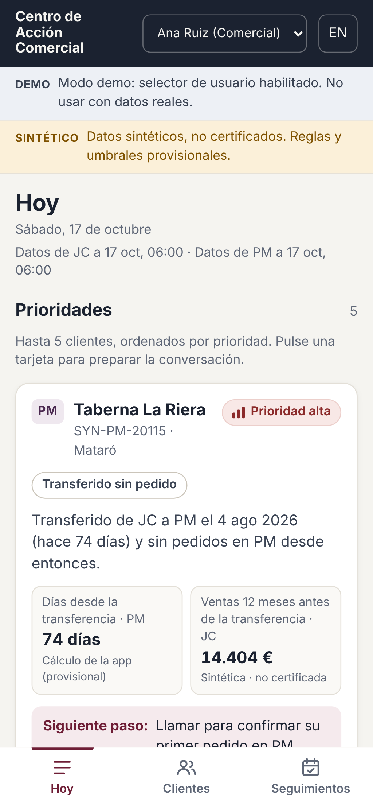
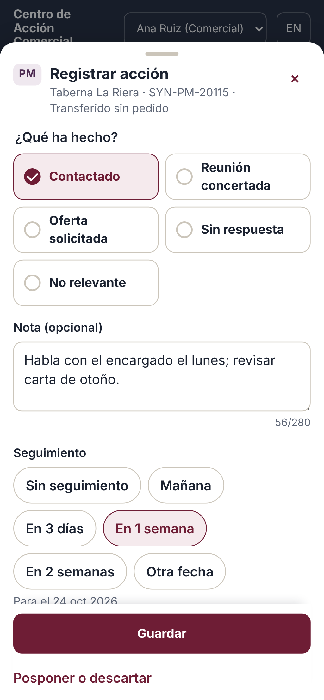
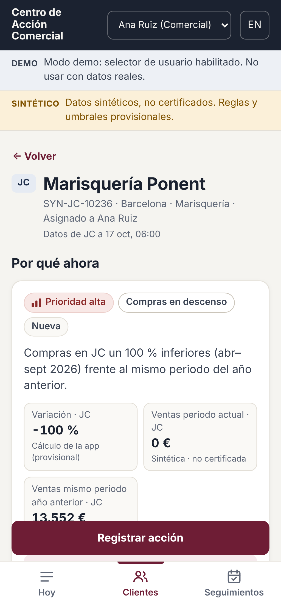
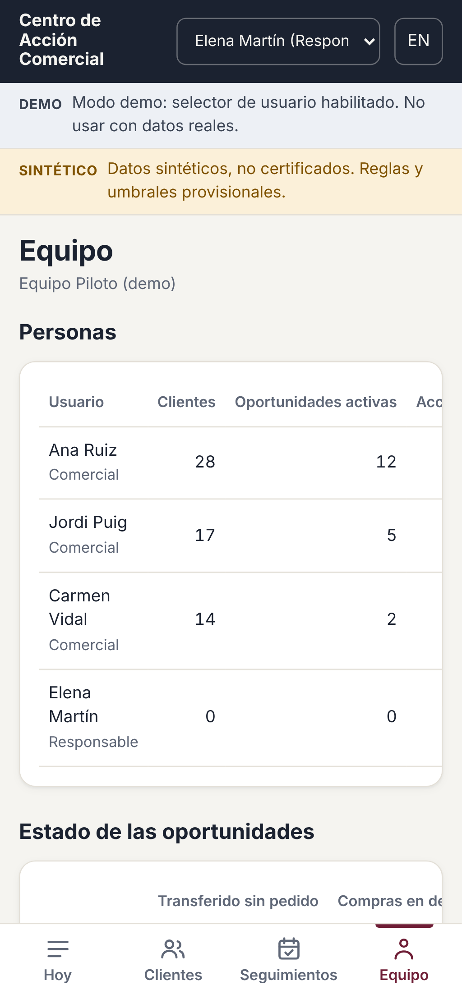

# JC / PM Commercial Action Centre (prototype)

A mobile-friendly internal app that helps salespeople decide **which customers to focus on today**, see **what changed and the evidence behind it**, **record what they did** in under 30 seconds, and track **what happened afterwards**.

> **Status: prototype milestone 1. Synthetic data, provisional rules.**
> No commercial definition, threshold or JC↔PM mapping has been approved yet ([docs/GAPS.md](docs/GAPS.md)).
> All data in this repository is synthetic and labelled as such. No live company system is connected. Nothing is written back to the ERP, and no messages are sent.

| Today (phone) | Record an action | Account detail | Manager view |
|---|---|---|---|
|  |  |  |  |

More screenshots (phone and desktop, including the stale-data, empty, English and demo-picker states) are in [docs/screenshots](docs/screenshots).

## What it does

- **Hoy / Today:** up to five prioritised customers, one card per customer. Each card shows a plain-language reason, the key figures with their provenance, a priority shown as text and bars (never colour alone), and one clear next step. Follow-ups due today and overdue are listed alongside.
- **Three provisional opportunity types:**
  - transferred customers who have not reordered (approved mapping only);
  - declining purchases (same months a year earlier, with minimum history and materiality);
  - overdue against the customer's own ordering cadence.
- **Suppression:** stale sources, unapproved or ambiguous mappings and incomplete data suppress recommendations and appear as **data issues**.
- **Account detail:**
  - commercial summary (this entity only) and the evidence table, with measure, certification status, period, source and refresh time;
  - linked JC/PM account through an approved mapping, with figures kept separate;
  - recent purchases, action history and rule-by-rule evaluation;
  - conversation points from deterministic templates, plus an optional guarded AI draft.
- **Recording an action:** contacted / meeting booked / offer requested / no response / not relevant, an optional note (≤ 280 characters) and a one-tap follow-up date. Snooze or dismiss with a reason. Completing an action is never presented as an outcome.
- **Seguimientos / Follow-ups:** overdue, today, upcoming and recently done; reschedule or cancel.
- **Equipo / Team (managers):**
  - members with assignments, active opportunities, actions and overdue follow-ups;
  - opportunity status by type;
  - **observed** post-action orders, with an explicit "not proven incremental impact" caveat;
  - data issues in scope;
  - reassignment within the manager's own teams only.
- **Admin:** versioned and audited provisional rule configuration, data issues, "data incorrect" reports from users, import history, re-evaluate now.
- **Languages:** Spanish by default; English via the language toggle. Every string sits in typed catalogues (`frontend/src/i18n`).

## Architecture

```
frontend/  React 18 + TypeScript + Vite, react-router, TanStack Query; plain CSS design tokens
backend/   Python 3.13, FastAPI, SQLAlchemy 2, Alembic, PostgreSQL 16
  app/rules/      pure-function opportunity rules + provisional parameters
  app/importer/   import contract (single source of truth), validator, snapshot loader
  app/services/   access scope, refresh job, audit, snapshot
  app/api/        JSON API (/api/*); also serves the built SPA
  app/ai/         deterministic talking points, optional provider adapter, output guard
  app/synthetic/  synthetic JC/PM generator and demo seed
docs/      gap list, rules, data dictionary, integration checklist, test results, screenshots
data/templates/  import templates (fictitious example rows)
```

- **One deployable:** the API serves the built SPA. A second process, `python -m app.cli scheduler`, imports new packages from an inbox folder and re-evaluates opportunities on a schedule. There are no microservices, agent frameworks or vector stores.
- **Three separate schemas:**
  - `facts`: read-only commercial facts, written only by the importer and refresh job;
  - `app`: tasks, notes, assignments and opportunities, with an append-only audit log enforced by a DB trigger;
  - `ai`: drafts plus the exact facts they were given.
- **Access control on the server:**
  - salespeople see their assigned accounts;
  - managers see their teams' accounts;
  - admins manage configuration.
  
  Out-of-scope records return 404.
- **Authentication fails closed:**
  - an unset `AUTH_MODE` rejects every request;
  - production refuses to start in demo mode;
  - Entra ID token validation is **scaffolded** (see the checklist).

## Run it locally

Prerequisites: Python 3.12+, Node 22+, PostgreSQL 16 (local install, or the `db` service in `docker-compose.yml`).

```bash
# 1. Database (skip if using: docker compose up -d db)
createuser -P cac            # password: cac_local_dev  (local development only)
createdb -O cac cac_dev
createdb -O cac cac_test     # for the backend test suite

# 2. Configuration
cp .env.example backend/.env # AUTH_MODE=demo, synthetic data only

# 3. Dependencies
make setup                   # backend venv + pip install, frontend npm ci

# 4. Schema and synthetic demo data
make migrate
make seed                    # users, synthetic JC/PM package, refresh, sample action history

# 5. Build the UI and start the server
make build
make api                     # http://localhost:8000
```

Open **http://localhost:8000**, pick a demo user, and try:

| Demo user | Role | Sees |
|---|---|---|
| Ana Ruiz | Sales (Equipo Piloto) | her accounts; richest demo journey |
| Jordi Puig, Carmen Vidal | Sales (Equipo Piloto) | their accounts |
| Elena Martín | Manager, Equipo Piloto | Ana, Jordi and Carmen's accounts, plus Team |
| David Serra, Lucía Ortega / Pablo Ferrer | Sales / Manager, Equipo B | a second team, used to show isolation |
| Admin (demo) | Admin | everything, plus Admin |

**Frontend dev server with hot reload:** keep `make api` running, then run `make web` and open http://localhost:5173 (it proxies `/api` to port 8000).

**Simulate a stale source:**

```bash
cd backend && .venv/bin/python -m app.cli seed-demo --stale-entity PM
```

**Other commands** (`cd backend && .venv/bin/python -m app.cli <cmd>`):

| Command | Purpose |
|---|---|
| `validate <folder>` | check an import package against the contract (report only) |
| `import <folder>` | validate, load as a snapshot, re-evaluate |
| `refresh` | re-evaluate opportunities now |
| `scheduler [--once]` | inbox import + refresh loop (`IMPORT_INBOX`, `SCHEDULER_INTERVAL_MINUTES`) |
| `generate-synthetic --as-of YYYY-MM-DD` | write a synthetic package to `data/synthetic/` |
| `create-user --email … --role …` | provision a user (Entra object ID optional) |
| `contract-docs`, `contract-templates` | regenerate the data dictionary tables and the CSV templates |

## Tests

```bash
make test-backend   # pytest against TEST_DATABASE_URL (rules, import, refresh, access, workflow, AI guard)
make test-frontend  # TypeScript check + vitest (i18n parity, text/provenance labelling)
make e2e            # Playwright journeys on phone (390×844) and desktop (1366×900); API must be running
make screenshots    # regenerate docs/screenshots
```

Playwright uses its own Chromium. To reuse a system Chromium, set `PW_CHROMIUM_PATH`.

Latest results: [docs/TEST_RESULTS.md](docs/TEST_RESULTS.md).

## Documentation

- [docs/GAPS.md](docs/GAPS.md): **missing definitions, fields and integration requirements**; confirmed rules vs provisional assumptions
- [docs/RULES.md](docs/RULES.md): opportunity rules, suppression, priority, workflow rules
- [docs/DATA_DICTIONARY.md](docs/DATA_DICTIONARY.md): import contract, tables, evidence format, synthetic cases
- [docs/INTEGRATION_CHECKLIST.md](docs/INTEGRATION_CHECKLIST.md): Entra ID, certified Fabric/Power BI data, MiPM, hosting
- [docs/TEST_RESULTS.md](docs/TEST_RESULTS.md): test results and known limitations

## Governance

- **Internal material stays out of Git.** Reference packs, semantic-model guides, MiPM screenshots and any real or anonymised extracts go in `private/` or `data/extracts/`; both are gitignored. Commit them only with explicit approval.
- **No secrets in the repository.** Use `backend/.env` locally (gitignored) and a secret store when hosted.
- **The app does not:**
  - label customers as lost;
  - match JC and PM customers by name;
  - add JC and PM figures together;
  - rebuild financial measures from raw fields;
  - present synthetic or provisional figures as certified;
  - attribute later sales to actions.

## Known limitations (prototype)

- **Data and rules:** all data is synthetic, and every rule and threshold is provisional (see GAPS).
- **Entra ID:**
  - backend token validation is unit-tested only with locally signed tokens;
  - frontend sign-in (MSAL) is **not implemented**, so in `entra` mode the UI explains that sign-in is not connected;
  - users are provisioned through the CLI.
- **Integrations not built:** no connection to Fabric/Power BI, MiPM or the ERP; the import contract is the integration seam. The AI adapter is off by default and has not been called against a live API.
- **Deployment not verified:** the Dockerfile and `docker-compose.yml` were not built or run here (no Docker daemon). The tested path is the local one above.
- **Scale and features:**
  - pilot-scale implementation: scope and snapshot calculations load customer facts in memory, which is fine for thousands of customers but not tuned beyond that;
  - comparison windows use calendar months; JC's fiscal calendar is not modelled (gap D4);
  - no offline mode, push notifications or calendar integration.
